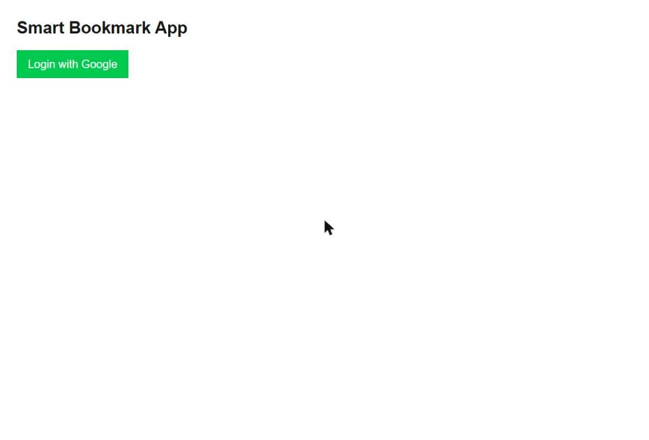

# 🔖 Smart Bookmark App

A simple bookmark manager where you sign in with Google and save your favourite links. Each user only sees their own bookmarks.

**Live Demo:** https://smart-bookmark-app-iota-three.vercel.app

## 📸 Screenshot



## ✨ Features

- 🔐 Google sign-in with Supabase Auth (session is kept across reloads)
- ➕ Add bookmarks with a title and URL
- 📋 Bookmarks listed newest first
- 👤 Per-user data: each user only sees the bookmarks they saved
- 🚪 Logout

## 🛠️ Tech Stack

- **Frontend:** Next.js 16 (App Router), React 19, TypeScript
- **Styling:** Tailwind CSS 4
- **Backend / Auth / Database:** Supabase (Google OAuth + Postgres)
- **Deployment:** Vercel

## 🚀 Getting Started

1. Clone the repo and install dependencies

   ```bash
   git clone https://github.com/Poojakk112/smart-bookmark-app.git
   cd smart-bookmark-app
   npm install
   ```

2. Create a `.env.local` file

   ```env
   NEXT_PUBLIC_SUPABASE_URL=your_supabase_project_url
   NEXT_PUBLIC_SUPABASE_ANON_KEY=your_supabase_anon_key
   ```

3. In Supabase, enable the **Google** auth provider and create a `bookmarks` table with the columns `id`, `title`, `url`, `user_id` and `created_at`.

4. Start the dev server

   ```bash
   npm run dev
   ```

   Open http://localhost:3000.
